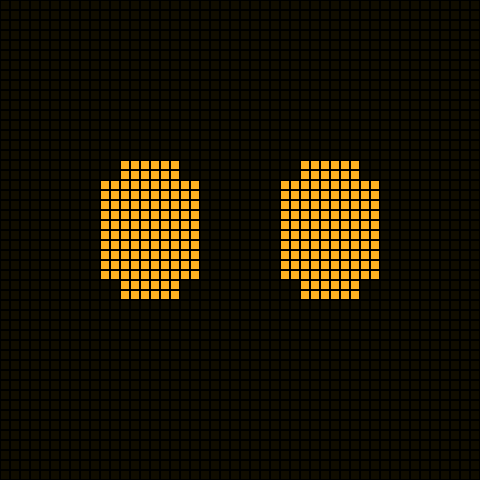
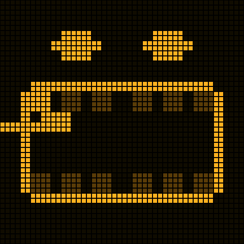
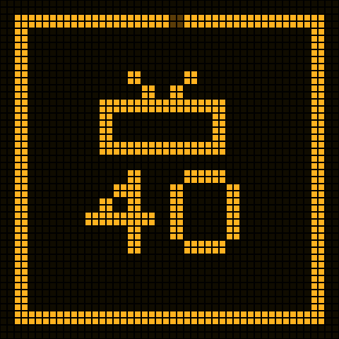
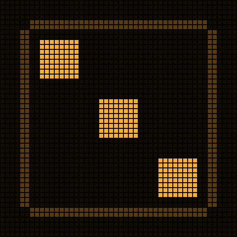
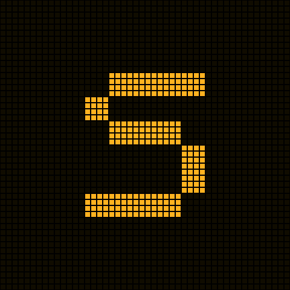
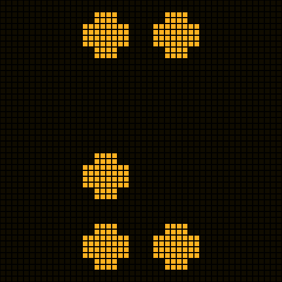
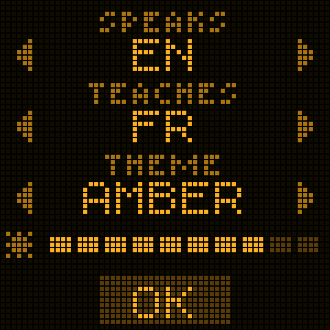
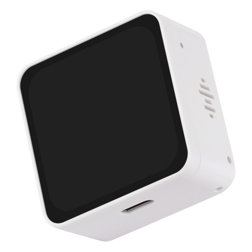

# Cubey

[](https://github.com/nickustinov/cubey/actions/workflows/ci.yml)
[](LICENSE)

**A small talking cube for children aged 2–6.** Cubey is a kind and curious friend with two glowing eyes on a board of dots. A child talks with it hands-free about anything; it answers in a warm voice, remembers their talks before, and does a few things besides talking: brushing teeth, timers, games with letters and numbers, drawing on its screen, teaching words of another language.

<table>
  <tr>
    <td></td>
    <td></td>
    <td></td>
    <td></td>
    <td></td>
  </tr>
  <tr>
    <td></td>
    <td></td>
    <td></td>
    <td></td>
    <td></td>
  </tr>
</table>

## Why

Cubey is a parenting tool, not a screen, a toy or a chatbot.

- **Back to real life.** A talk ends with the child's goodbye, or when they go quiet for half a minute. Cubey never asks them to stay, come back or talk more.
- **The parent is in the loop.** Every question and answer goes to the parents' log, word for word. The big questions (death, babies, bodies, faith, family matters, war, the child's health, someone hurting them) are not answered but handed to the parents.
- **Warm and calm.** Nothing that invites staring. There is no text for the child to read, only what Cubey writes as it says it (a word spelled, a sum). Eyes, pictures and voice.
- **Private.** No audio is kept. Provider keys stay on the server, never on the cube.
- **Nothing to set up.** No app. Cubey gets to know the child by talking with them (their name, their age), as a friend would.

## What it can do

Cubey understands what the child means in any words, in the language it speaks: English, French, German, Spanish, Italian, Portuguese, Dutch, Polish, Swedish, Danish, Norwegian, Finnish, Estonian, Russian, Ukrainian, Latvian or Lithuanian. The phrases below are examples, not exact commands.

### Talking

| Say | What happens |
| --- | --- |
| Anything: "Why is the sky blue?", "I had pancakes today" | A short, true answer for their age, often with an easy question back |
| "Tell me a story", "Tell me about the Three Little Pigs" | A whole tale in one go: a beginning, something that happens, a happy end |
| "I'm Nick now", "I'm five" | Cubey uses the new name or age from then on and remembers it |
| A grown-up: "This is Anna, she is three" | The same, told by a grown-up |
| "Bye", "I'm done", "Goodnight" | A short goodbye with no question, and Cubey goes to sleep |

Now and then, when it fits, Cubey offers something it can do, as a question ("Shall we brush your teeth?"), and starts only after a yes.

### Routines and games

| Say | What happens |
| --- | --- |
| "Let's brush my teeth" | Cubey's mouth shows. The child fetches their toothbrush and taps the screen to start two minutes: four parts of 30 s round the mouth, Cubey saying where to brush next and praising them at the end |
| "Stop brushing" | Brushing stops |
| "Set a timer for cartoons for 40 minutes" | A dial with the minutes left and a bar running round the screen (1–180 minutes). Reminders at 5 and 1 minute left; at the end Cubey asks whether they've finished |
| "How much battery do you have?" | The percentage left, and whether it's charging, said and shown as a battery of dots |
| "Roll the dice", "Roll a die for our game" | A die tumbles on the screen and Cubey says the number. Shake the cube or tap the screen to roll again |
| "Let's play finding things" | Cubey asks the child to find one safe thing in the room (something red, something soft…) and waits up to three minutes while they look |
| "Let's play a word chain" | Each word starts with the last letter of the one before. The words scroll across the screen and the letter to go on from shows big |
| "Let's name words on one letter" | Cubey picks a letter, shows it big and counts the child's words on it, with hints and a new letter every few words |
| "How do you write 'cat'?", "Let's spell words" | Cubey says the word and spells it letter by letter: each letter lights up big on the screen the moment Cubey says it, then the whole word passes. In the game, Cubey then asks for the next word |
| "Let's count", "Play how many dots" | 1 to 10 dots show on the screen to count: few at first, more once the child counts easily |
| "Draw me a cat", "What's 12 plus 34?" | Cubey draws a picture or writes the sum on its screen for a few seconds; while it draws, faint dots come and go on the screen like a sketch forming. Now and then it draws something by itself, as a surprise |
| "I want to learn English", "Parrot", "Let's learn French instead" | The word game: picture cards fill the screen and Cubey teaches words of the language the child chose, step by step. Asked the first time, Cubey asks which language (any of 60), remembers it, and switches when the child asks for another; each language keeps its own progress. The child answers by saying the word or tapping the right picture. It goes on from where they stopped last time, and ends when they want to stop or ask for something else |

Saying something unrelated while a game with letters, dots or spelling is on ends that game.

### For grown-ups

| Say | What happens |
| --- | --- |
| "Make your screen brighter", "Dimmer", "Set the brightness to 40%" | The screen's brightness changes (10–100%) |
| "Louder", "Quieter", "Set the volume to 50%" | Cubey's volume changes (10–100%), heard as it answers |
| "Turn red", "Be orange", "Make your colour white" | Cubey's colours change: amber (orange), green, red, blue, turquoise (VFD) or white |
| "Open your menu", "Change your language", "Change your colours" | The grown-ups' menu opens on the screen |
| "Set up your Wi-Fi" | The Wi-Fi setup opens on the screen |

### Questions for the parents

Cubey doesn't answer these. It says warmly that they are great questions for the parents, and marks them in the parents' log: death and dying, where babies come from, bodies and private parts, God and religion, Santa, the tooth fairy and other family traditions, family matters (divorce, money, arguments), war, violence and scary news, why people look or live differently, and the child's own health when they're ill or hurt. If a child says someone hurt them, or something unsafe happened, Cubey tells them gently to tell their parents right now, and marks that too.

### Buttons and touch

| Do | What happens |
| --- | --- |
| Press the power button while it's asleep | Cubey wakes with a hello that goes on from their last talk |
| Press the power button while it's awake | A step back: from a routine (brushing, a timer, the dice, the word game, a drawing) to Cubey's eyes, and from its eyes to sleep |
| Hold the power button (2 s) | Sleep |
| Hold "–" for 5 s | The grown-ups' menu, in two pages: the language Cubey speaks and the screen's theme (amber, green, red, blue, VFD, white); then the screen's brightness and Cubey's volume. Tap the arrows beside a line to change it, slide a slider, tap the page dots to turn the page, OK to save |
| Hold "+" for 5 s | The Wi-Fi setup: the networks around, tap one, type the password on a keyboard of dots |
| Tap the screen | Starts brushing, picks a picture in the word game, rolls the dice again |
| Shake the cube | Rolls the dice again |
| Put the cube down on any side | The picture turns to stay upright |

Cubey sleeps after half a minute of quiet, and after 45 s without its server.

## How it works

```
                 one WebSocket                  ┌──▶ Soniox: speech to text
  the cube  ◀──────────────────────▶  server ───┼──▶ a language model: Cubey's answer, as JSON
  (ESP32-S3)   mic audio, messages    (Bun)     ├──▶ Soniox: text to speech
                 speech, routines       │       └──▶ (or Gemini Live, speech to speech)
                                        └── SQLite, memory.md and the parents' log per Cubey
```

- **The cube** streams the microphone to the server, plays Cubey's voice and draws everything on a 24 by 24 board of dots: the eyes, a timer's dial, a die, letters, drawings. It cancels its own echo, so the child can talk over Cubey.
- **The server** hears the child through Soniox. A model writes Cubey's answer as JSON: what it says, plus a goodbye, a question for the parents, or a routine to start. The words are spoken by Soniox's voice as they're written, so Cubey starts speaking before the answer is finished. Each routine becomes a message the cube turns into a screen.
- **A model for each job**, chosen on the admin page: one for the talk, one for the games with words and the word game, one for drawing. By default Gemini 3.5 Flash-Lite, the quickest and cheapest, and GPT-6 Astra for drawing when there's an OpenAI key.

The reasoning behind each choice is in [docs/design.md](docs/design.md).

## What you need

**To develop** (the simulator runs Cubey on a Mac, with its microphone and speaker):

- macOS with Homebrew: `brew install cmake ninja sdl2`
- [Bun](https://bun.sh) 1.4 or later
- API keys:
  - [Soniox](https://soniox.com): speech to text and text to speech.
  - [Gemini](https://aistudio.google.com) or [OpenAI](https://platform.openai.com), or both: the models Cubey thinks with. Gemini gives Gemini 3.5 Flash-Lite (the default), Gemini 3.1 Flash-Lite and speech to speech on Gemini Live (`CUBEY_TALK=live`); OpenAI gives GPT-6 Sol and GPT-6 Astra (the best at drawing).

**To build a cube:**

<a href="https://www.waveshare.com/product/esp32-related/boards-kits/esp32-s3/esp32-s3-touch-amoled-2.16.htm"></a>

- A [Waveshare ESP32-S3-Touch-AMOLED-2.16](https://www.waveshare.com/product/esp32-related/boards-kits/esp32-s3/esp32-s3-touch-amoled-2.16.htm), the cube Cubey runs on: a 2.16" square AMOLED touch screen in a small case. The firmware uses its screen, touch, microphones, speaker, accelerometer, battery gauge and buttons.
- [ESP-IDF](https://docs.espressif.com/projects/esp-idf/) 6.1.

**To host the server:** any machine that runs Bun and keeps a small volume. A [Fly.io](https://fly.io) configuration and a Dockerfile are included.

All the providers bill per use. The admin page shows what each Cubey costs, by day and by kind.

## Quick start: the simulator

```sh
git clone https://github.com/nickustinov/cubey.git && cd cubey
cp server/.env.example server/.env          # add SONIOX_API_KEY, and GEMINI_API_KEY or OPENAI_API_KEY
cd server && bun install && bun run dev     # the server, on ws://127.0.0.1:8788/device
```

In another terminal:

```sh
cmake -S firmware -B build/firmware -G Ninja && cmake --build build/firmware
build/firmware/platforms/mac/cubey-sim
```

macOS asks for microphone access for your terminal. The first time, Cubey's language menu opens by itself: click the arrows to choose, then OK. Then talk.

In the simulator window the mouse is a finger, `p` is the power button (`shift+p` held long), `=` and `-` are the "+" and "–" keys, `b` changes the pretend battery, `r` turns the cube a quarter and `s` shakes it.

## Deploying the server

The included `fly.toml` runs one always-on machine in Frankfurt with a 1 GB volume for SQLite and the logs.

```sh
# Choose your own app name in fly.toml (app = "…"), then:
fly apps create <your-app>
fly volumes create cubey_data --region fra --size 1
fly secrets set SONIOX_API_KEY=… OPENAI_API_KEY=… GEMINI_API_KEY=… \
  CUBEY_DEVICE_TOKEN=$(openssl rand -hex 32) CUBEY_ADMIN_PASSWORD=…
fly deploy
```

Set the provider keys you have: `GEMINI_API_KEY`, `OPENAI_API_KEY` or both. Your cubes then connect to `wss://<your-app>.fly.dev/device`, and the admin page is at `https://<your-app>.fly.dev/admin`.

## Building and flashing a cube

1. Install ESP-IDF 6.1: clone it into `~/esp/esp-idf-v6.1` and run `./install.sh esp32s3`.
2. Create `firmware/platforms/esp32/sdkconfig.local` (git-ignored) with your server and its device token:

   ```
   CONFIG_CUBEY_SERVER_URL="wss://<your-app>.fly.dev/device"
   CONFIG_CUBEY_DEVICE_TOKEN="<your CUBEY_DEVICE_TOKEN>"
   ```

   To develop against your Mac instead, use `ws://<your-mac>.local:8788/device`, and set `HOST=0.0.0.0` and `CUBEY_DEVICE_TOKEN` in `server/.env`.
3. Build and flash:

   ```sh
   . ~/esp/esp-idf-v6.1/export.sh
   idf.py -C firmware/platforms/esp32 -B build/esp32 build
   idf.py -C firmware/platforms/esp32 -B build/esp32 -p /dev/cu.usbmodem* flash monitor
   ```

After changing `sdkconfig.local`, delete `firmware/platforms/esp32/sdkconfig` so the build picks it up.

### A new cube's first start

A freshly flashed cube says "HI!" and opens its Wi-Fi setup: tap to start, pick a network, type the password. The server meets it for the first time, keeps its key, and opens its language menu: the language Cubey speaks. Then Cubey introduces itself and asks the child's name. Every cube runs the same firmware; each has its own child, history and parents' log on the server.

## The admin page

`/admin` on the server, behind `CUBEY_ADMIN_PASSWORD`:

- the models Cubey thinks with, a dropdown for each job (talk, games, drawing), used from the next turn; a model whose provider key isn't set is greyed out
- every Cubey, its child, whether it's online, and what it cost today, this month and in all
- a Cubey's talks, word for word, with the big questions marked
- its child's name, age and languages, its theme, brightness and volume, its name, blocking it
- a full reset, which wipes a Cubey on the server and, if it's on, the cube itself
- where the money goes: by day, by Cubey and by kind (listening, speaking, each model)

`cd server && bun run log` prints the parents' log in the terminal.

## Configuration

Everything is in `server/.env` (see [`server/.env.example`](server/.env.example)):

| Variable | What it sets |
| --- | --- |
| `SONIOX_API_KEY` | Soniox: hearing and speaking |
| `GEMINI_API_KEY`, `OPENAI_API_KEY` | The models' providers, one or both: which models the admin page offers. Gemini Live needs `GEMINI_API_KEY` |
| `CUBEY_TALK` | `cascade` (default: Soniox and a model) or `live` (speech to speech on Gemini Live, with only the battery, brushing and timers) |
| `CUBEY_TALK_OVER` | `0` turns off talking over Cubey while it speaks |
| `CUBEY_ADMIN_PASSWORD` | The admin page; no password, no page |
| `CUBEY_CHILD_TIMEZONE` | The household's time zone, so Cubey knows the time of day |
| `HOST`, `CUBEY_DEVICE_TOKEN` | `0.0.0.0` and a long random token, to let cubes on the network connect |
| `CUBEY_DATA` | Where the data lives (`server/data` by default, `/data` on Fly) |

## Before a child uses it

Cubey talks with young children through third-party AI providers. **Check each provider's terms for use by children before a child uses it.** Gemini's terms forbid apps used by under-18s; OpenAI's and Soniox's need checking for your use and country. Read the parents' log, and adjust the prompt (`server/src/cubey.ts`) to your family.

## Development

[CLAUDE.md](CLAUDE.md) is the developer guide: the repository map, commands, how we work, adding a routine, and the gotchas. It serves people and coding agents alike. [docs/design.md](docs/design.md) explains the decisions; [CONTRIBUTING.md](CONTRIBUTING.md) explains how to propose a change.

```sh
cd server && bun test && bunx tsc --noEmit             # server tests and types
ctest --test-dir build/firmware --output-on-failure    # firmware tests
```

## Acknowledgements

- [LVGL](https://lvgl.io) draws the screen; [doctest](https://github.com/doctest/doctest) tests the firmware; [cJSON](https://github.com/DaveGamble/cJSON) reads its messages.
- [ESP-IDF](https://github.com/espressif/esp-idf) and [esp-sr](https://github.com/espressif/esp-sr) (echo cancelling and voice detection) run the board, with Waveshare's board support package.
- The word game's pictures are [Microsoft Fluent Emoji](https://github.com/microsoft/fluentui-emoji) (MIT, see [content/lesson/LICENSES.md](content/lesson/LICENSES.md)).
- [Soniox](https://soniox.com), [OpenAI](https://openai.com) and [Google Gemini](https://ai.google.dev) hear, think and speak.

## License

[MIT](LICENSE)
